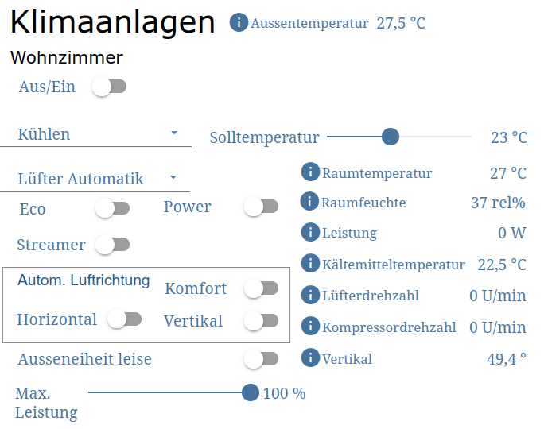

<p align="right"><a href="https://buymeacoffee.com/raw07" target="_blank"></a></p>

# Faikout – IOBroker Integration

[English](#english) | [Deutsch](#deutsch)

---

## English

Automatic setup of all [IOBroker](https://www.iobroker.net) alias data points for the [Faikout](https://codeberg.org/RevK/ESP32-Faikout) ESP32 controller.

### What is the Faikout?

The Faikout is an ESP32 board connected to the S21 service port of a Daikin indoor unit. It controls the air conditioner fully locally via MQTT – no cloud required.

### What does this script do?

The script [`faikout_alias_generator_en.js`](https://codeberg.org/RaW07/faikout-iobroker/raw/branch/main/faikout_alias_generator_en.js) is run once in the IOBroker JavaScript adapter. It connects to the Faikout via HTTP, automatically detects which features the device supports, and creates matching alias data points under `alias.0.<name>.*`.

- Only active features are created (disabled features like streamer, LED, humidifier etc. are skipped)
- Re-running the script compares against the currently active features of the Faikout – alias data points for features that are known but no longer active are automatically removed
- Re-running is therefore also designed as an update and can be used whenever Faikout settings change
- Supports both the [`mqtt-client`](https://github.com/iobroker-community-adapters/ioBroker.mqtt-client) adapter (recommended) and the standard [`mqtt`](https://github.com/ioBroker/ioBroker.mqtt) adapter

### Prerequisites

- Faikout already connected to IOBroker via MQTT, status topic delivering data
- [IOBroker JavaScript adapter](https://github.com/ioBroker/ioBroker.javascript) installed
- In the JavaScript adapter: **"Allow setObject command" = ON**
  (Admin → Instances → javascript.X → Settings)

### Setup

1. Copy [`faikout_alias_generator_en.js`](https://codeberg.org/RaW07/faikout-iobroker/raw/branch/main/faikout_alias_generator_en.js) into the JavaScript adapter
2. Adjust the configuration block at the top of the script:

```js
const FAIKOUT_IP    = '192.168.x.x';   // IP address of the Faikout
const MQTT_INSTANCE = 'mqtt-client.0';  // MQTT adapter instance (or 'mqtt.0')
const ALIAS_NAME    = 'MeineKlima';     // Folder name under alias.0.*
```

3. Run the script once – data points appear immediately under `alias.0.<name>`

For a second unit: run the script again with a different IP and `ALIAS_NAME`.

---

## Deutsch

Automatische Einrichtung aller [IOBroker](https://www.iobroker.net)-Alias-Datenpunkte für den [Faikout](https://codeberg.org/RevK/ESP32-Faikout) ESP32-Controller.

### Was ist der Faikout?

Der Faikout ist ein ESP32-Board, das über den S21-Serviceanschluss eines Daikin-Innengeräts betrieben wird und das Klimagerät vollständig lokal per MQTT steuert – ohne Cloud.

### Was macht dieses Script?

Das Script [`faikout_alias_generator_ger.js`](https://codeberg.org/RaW07/faikout-iobroker/raw/branch/main/faikout_alias_generator_ger.js) wird einmalig im IOBroker JavaScript-Adapter ausgeführt. Es verbindet sich mit dem Faikout per HTTP, erkennt automatisch welche Funktionen das Gerät unterstützt, und legt passende Alias-Datenpunkte unter `alias.0.<Name>.*` an.

- Nur aktive Features werden angelegt (deaktivierte Features wie Streamer, LED, Befeuchter etc. werden übersprungen)
- Bei erneutem Ausführen findet ein Abgleich mit den aktuell aktiven Funktionen des Faikout statt – Alias-Datenpunkte für bekannte, aber nicht mehr aktive Features werden automatisch entfernt
- Eine Mehrfachausführung ist somit als Update ausgelegt und bei Änderungen an den Faikout-Einstellungen jederzeit durchführbar
- Unterstützt [`mqtt-client`](https://github.com/iobroker-community-adapters/ioBroker.mqtt-client)-Adapter (Empfehlung) und Standard-[`mqtt`](https://github.com/ioBroker/ioBroker.mqtt)-Adapter

### Voraussetzungen

- Faikout bereits per MQTT mit IOBroker verbunden, Status-Topic liefert Daten
- [IOBroker JavaScript-Adapter](https://github.com/ioBroker/ioBroker.javascript) installiert
- Im JavaScript-Adapter: **„Kommando „setObject" erlauben" = EIN**
  (Admin → Instanzen → javascript.X → Einstellungen)

### Einrichtung

1. Script [`faikout_alias_generator_ger.js`](https://codeberg.org/RaW07/faikout-iobroker/raw/branch/main/faikout_alias_generator_ger.js) in den JavaScript-Adapter kopieren
2. Konfigurationsblock oben im Script anpassen:

```js
const FAIKOUT_IP    = '192.168.x.x';   // IP-Adresse des Faikout
const MQTT_INSTANCE = 'mqtt-client.0';  // MQTT-Adapter Instanz (oder 'mqtt.0')
const ALIAS_NAME    = 'MeineKlima';     // Ordnername in alias.0.*
```

3. Script einmalig ausführen – die Datenpunkte erscheinen sofort unter `alias.0.<Name>`

Für eine zweite Klimaanlage: Script mit anderer IP und anderem `ALIAS_NAME` erneut ausführen.

### Extras – Visualisierung

Großer Dank geht an [Uwe](https://sun-watch.net/), der nicht nur eine tolle PV-Logger-Lösung anbietet die bei mir seit Jahrzehnten fehlerfrei läuft, sondern hier auch durch eine fertige Visualisierung auf Basis von [Material Design Widgets](https://github.com/Scrounger/ioBroker.vis-materialdesign) für IOBroker VIS unterstützt hat:



Die View kann direkt in VIS importiert werden:
[`View-Klima-ioBroker.txt`](https://codeberg.org/RaW07/faikout-iobroker/raw/branch/main/View-Klima-ioBroker.txt)

> **Hinweis:** Die View verwendet die Alias-Datenpunkte aus diesem Projekt.
> Die Ordnernamen (`Klima-WZ`, `Klima-SZ`) müssen ggf. an den eigenen `ALIAS_NAME` angepasst werden.

---

Part of [faikout-projects](https://codeberg.org/RaW07/faikout-projects)
